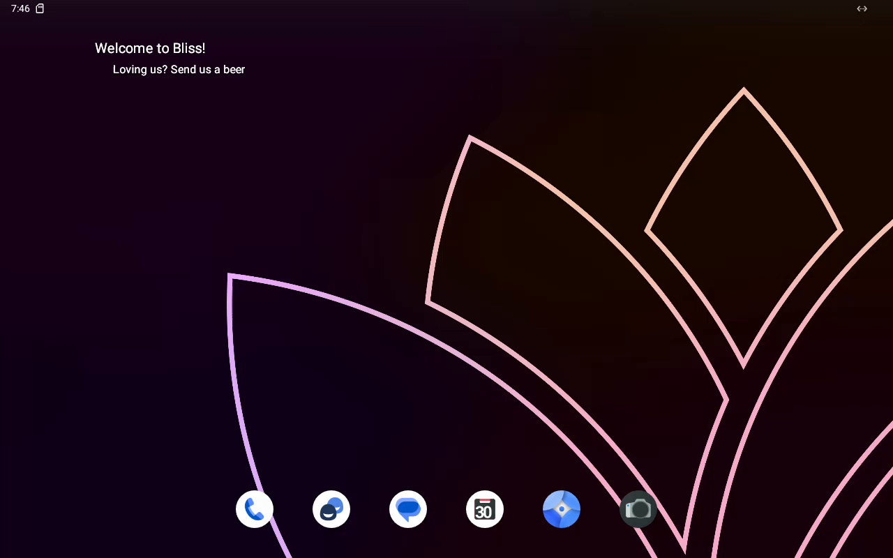

# Android in the lab

## Run Bliss OS

The `blissos-16` profile boots **Bliss OS 16.9.7 FOSS / Android 13** on QEMU/KVM.
This first version is a **temporary live session**, not an unattended installation:
apps, settings and files disappear when it stops. The disk is attached with QEMU
`-snapshot`; an existing disk is not overwritten. Use `android-live` again for
another session, rather than `start` (which boots an installed disk).

```sh
bin/vmctl android-live blissos-16
bin/vmctl android-console blissos-16 --fix-bliss-codecs --no-audio
```

Requires QEMU/KVM, xorriso (or bsdtar), adb and scrcpy on the host. `vmctl setup`
lists the optional Android tools; `vmctl setup --install adb scrcpy` installs the
host distribution's packages. Use **scrcpy 2.4 or newer** for the recording
options below; the complete flow was tested with **5.0**. See the upstream
installation links below for a release newer than the distribution package.

The live command validates the vendor SHA-256, extracts the ISO's kernel and
initrd, then starts Android in the background. The console waits up to 180 seconds
for `sys.boot_completed=1` (`--timeout` changes this), reconnects an offline ADB
transport, and selects only this VM's forwarded endpoint. Choose **Launcher3** and
**Always** at the first home chooser. Closing scrcpy leaves Android running.

The ordinary QEMU screen remains available:

```sh
bin/vmctl attach blissos-16
# Record without opening a scrcpy window:
bin/vmctl android-console blissos-16 --fix-bliss-codecs --no-audio \
  --no-playback --record /tmp/android.mp4 --time-limit 15
# Power off naturally (the codec workaround has already enabled root ADB):
adb -s 127.0.0.1:2373 shell reboot -p
```

The dashboard command center exposes `android-live` as a background job and
`android-console` as **Open in a terminal** on the host. Select the Bliss VM and
enable `--fix-bliss-codecs` and `--no-audio` in its options. VNC still works in
the browser; scrcpy opens on the host desktop, not inside the browser.

ADB listens without authentication in this userdebug image. Its host forward is
bound to **127.0.0.1:2373**, never to the LAN; clones use their allocated forward.
The 2024 build is useful for experiments, not a current Android security baseline.

## Verified result and codec workaround (2026-10-08)

Live checks passed through the actual CLI: `android-live`, boot completion,
`android-console --fix-bliss-codecs --no-audio`, both windowed and recording-only
scrcpy 5.0, and a second console launch with the workaround already applied.
The recordings contain H.264 frames at **1280 × 800**. This screenshot is a frame
from the windowed scrcpy recording, not a mockup:



Two guest changes are necessary for this pinned image:

- The profile uses `virtio-vga`, `GRALLOC=minigbm_arcvm` and
  `GRALLOC4_MINIGBM=1`. Standard VGA booted but its buffer format was rejected
  by the software encoder even after the linker fix.
- `--fix-bliss-codecs` requests root ADB, verifies the exact build fingerprint,
  Bliss version and mapper, then removes the ARM library search directories
  from **only Codec2's sphal namespace** in its generated linker configuration.
  Otherwise the x86 service tries to load an ARM `libbase.so`/`libcutils.so` and
  aborts with `gralloc-mapper is missing`. The script preserves the original in
  `/linkerconfig`, restarts `media.swcodec`, and is idempotent. All changed files
  live in guest tmpfs: a reboot regenerates them. The ISO and system image are
  unchanged. Other builds and graphics configurations are refused.

The workaround is explicit, not silently applied to arbitrary Android guests.
Its source is [`fix-bliss-codecs.sh`](../vms/profile-files/android/fix-bliss-codecs.sh).
Audio forwarding is not validated and the profile has no audio device; use
`--no-audio`. Host VA-API failed to initialize on the test machine, and scrcpy
successfully fell back to software decoding. No hardware-decoding claim is made.
Raw probe logs and MP4s stay in ignored `artifacts/android-research/`.
An unattended persistent installation and `android-lab` remain future work.

## Image research (2026-10-07)

The first candidate is **Bliss OS 16.9.7 FOSS, x86_64, 20241011**. This is
Android 13, not a current Android security baseline. The ISO was downloaded
from the project's SourceForge directory and matched its published SHA-256.
The FOSS variant avoids the Gapps bundle; it does not mean every binary is
free software (see the vendor's licensing page).

| Candidate | Evidence | Decision |
|---|---|---|
| Bliss OS 16.9.7 FOSS | Android 13; dated ISO and adjacent vendor `.sha256`; both BIOS and EFI boot menus include QEMU/KVM options | First candidate for live tests |
| Bliss OS 18 | The official source manifest identifies Android 15. The project says new public images are paused. No official downloadable ISO plus checksum was established in this research | Do not invent a URL or pin a community reupload |
| Android-x86 9.0-r2 | Released **2020-03-25**; the 2022 news concerns development and the SourceForge mirror. x86_64 ISO; release notes publish SHA-1, SourceForge file metadata also publishes SHA-256 and MD5 | Older fallback; Android 9 also lacks scrcpy audio forwarding |

Primary sources:

- [Bliss OS source branches and Android versions](https://github.com/BlissOS)
- [Bliss OS development status](https://blissos.org/status.html)
- [Bliss OS FOSS Generic release directory](https://sourceforge.net/projects/blissos-x86/files/Official/BlissOS16/FOSS/Generic/)
- [Bliss OS licensing](https://docs.blissos.org/legal/licensing/): mixed licensing,
  including AOSP Apache-2.0 and GPL components; its FAQ also lists proprietary
  components in public builds. Download upstream media; do not redistribute an
  ISO through this repository.
- [Android-x86 release notes](https://www.android-x86.org/releases/releasenote-9-0-r2.html)
  and [project/licensing](https://www.android-x86.org/): Apache-2.0 with GPL-2.0-or-later components.
- [Android-x86 official mirror](https://sourceforge.net/projects/android-x86/files/Release%209.0/)

## What the actual installation media contain

Both ISOs were downloaded and checked before inspection. Extracted files and
probe logs are in the ignored `artifacts/android-research/` directory. No image
was mounted on a host block device and no host partition was modified.

Bliss `boot/grub/grub.cfg` sources `efi/boot/android.cfg`. That file and
`isolinux/isolinux.cfg` offer `AUTO_INSTALL=0`, `AUTO_INSTALL=update`, and
`INSTALL=1`. Its QEMU/KVM entry uses `HWC=drm_minigbm GRALLOC=minigbm_arcvm`;
the software graphics entry uses `nomodeset HWACCEL=0`.

The unpacked `initrd.img` has a placeholder `scripts/1-install`. The real
installer is in **`install.img`**, unpacked by `/init` when `INSTALL` is set.
Reading only the placeholder would give the wrong conclusion.

- Bliss `/init:125` prompts with `read answer` for `AUTO_INSTALL`, even for
  `force`. Its yes branch prints that it will boot live; the other branch sets
  `INSTALL=1`. This is the actual shipped code, not an unattended interface to
  rely on.
- Bliss `install.img:scripts/1-install:138` skips the partition confirmation
  only for `AUTO_INSTALL=force`. Its EFI path has additional dialogs and
  `do_install:1140` always ends in a Run/Reboot menu.
- Android-x86 9.0-r2 `/init:16` directly maps `AUTO_INSTALL` to `INSTALL=1`.
  `install.img:scripts/1-install:69` recognizes `force`, but `do_install:581`
  still ends in a Run/Reboot menu.

Thus **neither stock menu entry is a complete, question-free lab bootstrap**.
The [Bliss Auto-Install documentation](https://docs.blissos.org/installation/using-auto-install/)
also calls that flow obsolete. Any lab bootstrap needs a separately tested
adapter with bounded failures, a serial FAILED token, and sync/flush before
the completion token and natural poweroff.

## ADB and graphics probes

The first Bliss live probe used QEMU/KVM, q35, 2 CPUs, 3072 MiB, standard VGA,
virtio-net, and `nomodeset HWACCEL=0 SETUPWIZARD=0`. Android reached the home
selection screen without screen input. ADB initially reported offline, then
connected on `127.0.0.1:2373` forwarded to guest TCP 5555. Read back:

```text
sys.boot_completed=1
ro.build.version.release=13
ro.adb.secure=0
settings get global adb_enabled -> 1
eth0 -> 10.0.2.15/24
ss -lnt -> *:5555
```

Both `service.adb.tcp.port` and `persist.adb.tcp.port` were empty. Setting them
was unnecessary for this build: the observed listener is the evidence. The
ISO's `system/build.prop` includes `ro.debuggable=1`, `ro.adb.secure=0`, and
`persist.sys.usb.config=adb`. This is not a promise about arbitrary Android
images. Bind the host forward to loopback, and do not expose it on the LAN.
`adb root`, followed by `adb shell reboot -p`, powered off this userdebug guest.

Standard VGA is sufficient for a graphical boot, but the initial scrcpy 5.0
H.264 and HEVC recording probes failed: Android's Codec2 service aborts with
`gralloc-mapper is missing`. This is a guest graphics/encoding failure, not
proof that host VA-API failed. The VNC screenshot remains useful evidence;
it is not evidence of a working scrcpy console.

## Host scrcpy

As checked on 2026-10-07, [Ubuntu's packages](https://packages.ubuntu.com/search?keywords=scrcpy&searchon=names&suite=all&section=all)
are 1.21-1 (22.04), 1.25-1ubuntu1 (24.04), 1.25-1.1 (25.10), and 3.3.4-1
(26.04). This host has Ubuntu 26.04, adb installed, and no packaged scrcpy.

[Upstream scrcpy 5.0](https://github.com/Genymobile/scrcpy/releases/tag/v5.0)
adds host hardware decoding. `--hwdec=auto` falls back to software;
`--hwdec=vaapi` selects VA-API on Linux and needs a working host VA-API driver.
This accelerates decoding on the host, not encoding inside Android.

Use the [official Linux release instructions](https://github.com/Genymobile/scrcpy/blob/v5.0/doc/linux.md)
for the x86_64 static archive or a source build. The downloaded 5.0 archive was
checked against the SHA-256 published there:
`f052ad9eb981879e8c5f066c5ef122b39b6c9853b383d6497219030e6549baed`.
The research copy is under `/tmp`, not installed into the host's PATH.

For an already listening guest, both forms are supported by the
[connection documentation](https://github.com/Genymobile/scrcpy/blob/v5.0/doc/connection.md):

```sh
adb connect 127.0.0.1:2373
adb -s 127.0.0.1:2373 shell getprop sys.boot_completed
scrcpy --serial=127.0.0.1:2373
# Or, once boot is complete:
scrcpy --tcpip=127.0.0.1:2373
```

Bare `scrcpy --tcpip` expects a USB device from which to discover/enable TCP;
it is not a substitute for explicitly selecting this VM's forwarded endpoint.
